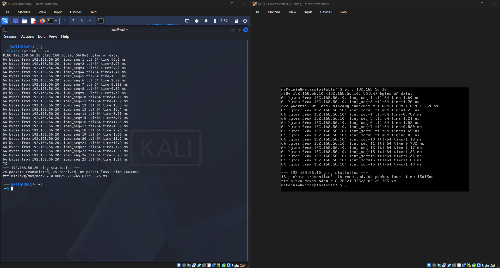
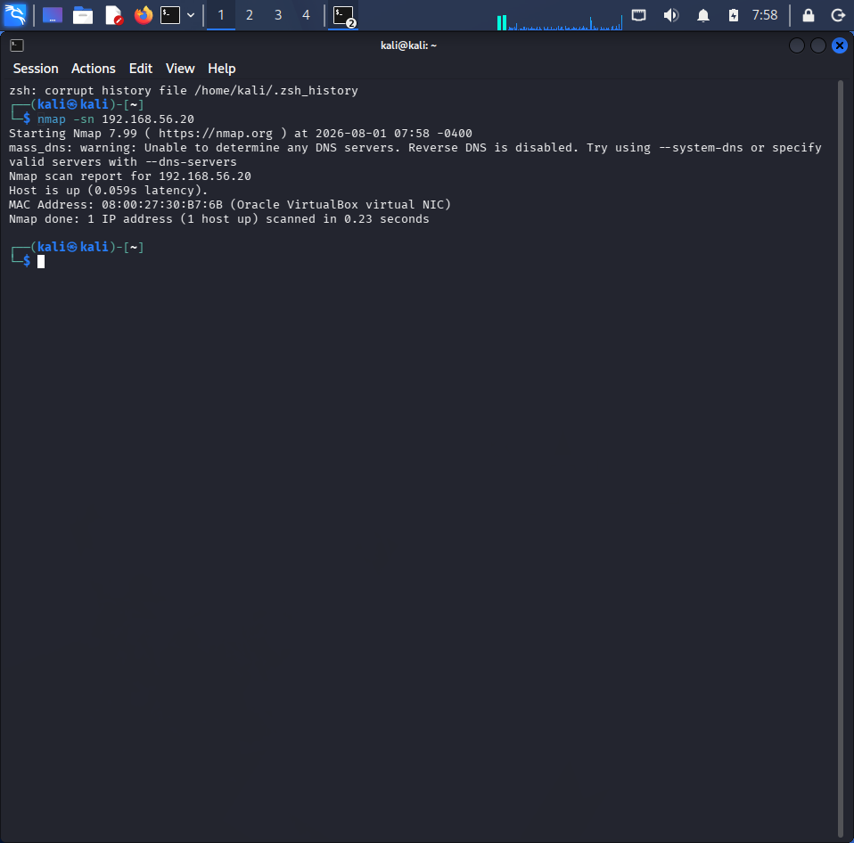
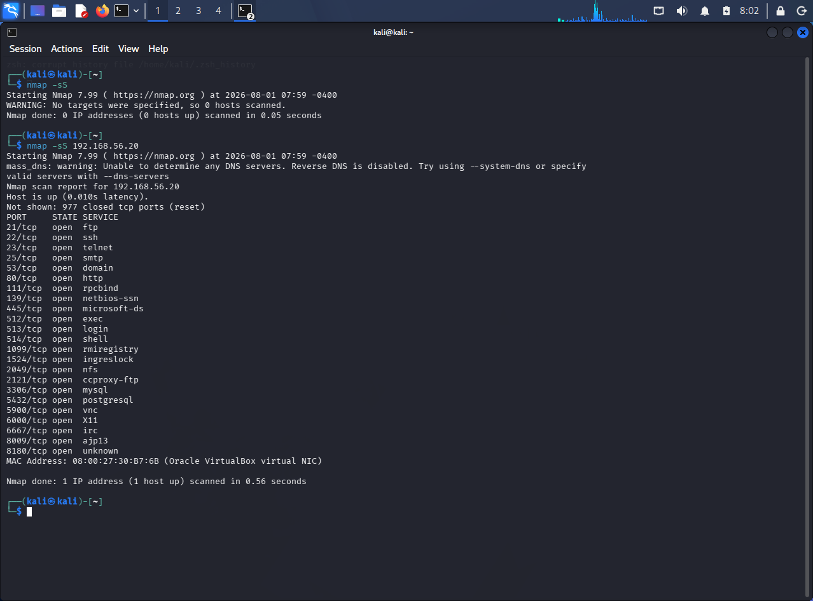
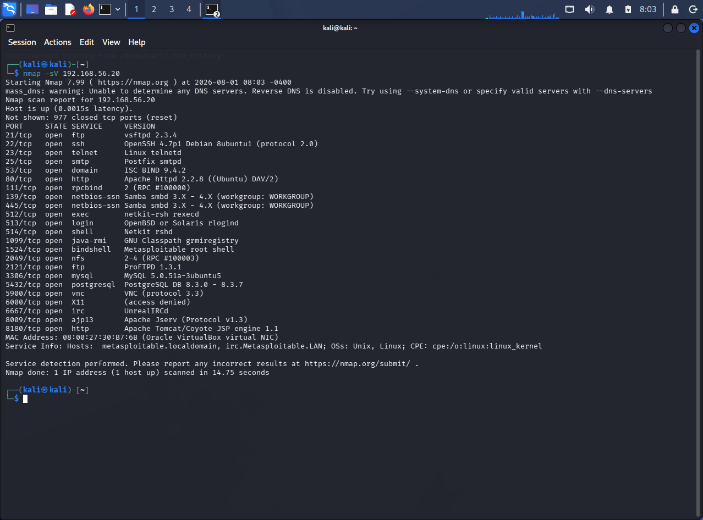
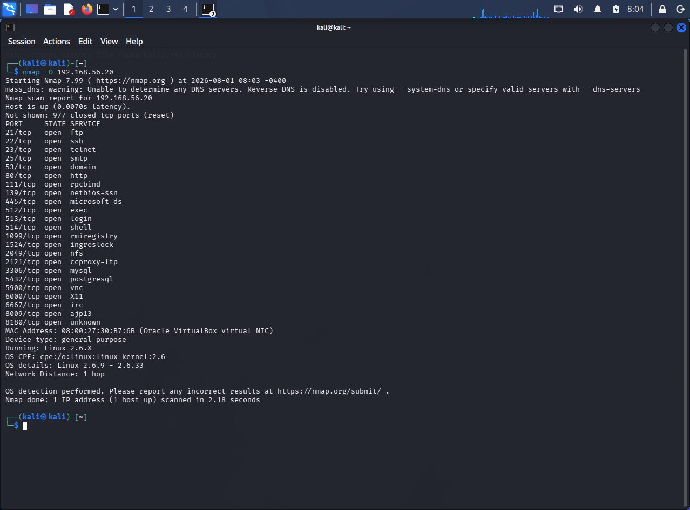
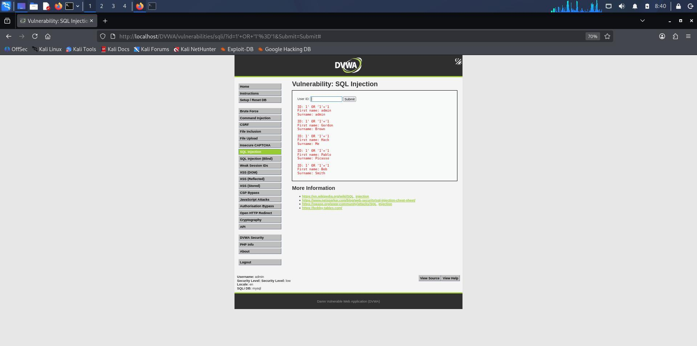
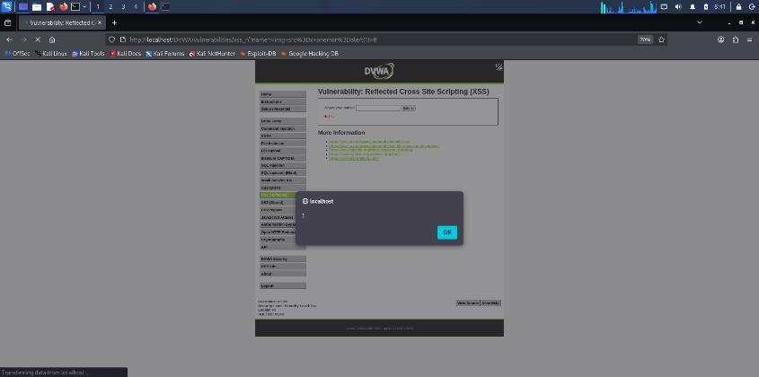

# Penetration-Testing Lab

**Lab reconnaissance, service assessment and web application security demonstrations**  
By [Emihle Cebisa](https://github.com/CebisaE/) | Academic practical work | August 2026

## Overview

I completed this practical assessment at Eduvos using Kali Linux, Metasploitable and Damn Vulnerable Web Application (DVWA). I built a host-only virtual lab, checked connectivity, performed reconnaissance, documented potential service weaknesses and demonstrated application vulnerabilities in DVWA.

**Scope:** My own authorised training environment with deliberately vulnerable targets. This repository documents completed coursework, not testing against public websites or third-party systems.

## Tools and environment

| Component | Role |
| --- | --- |
| Oracle VirtualBox | Virtual machine environment |
| Kali Linux / KALI01 | Testing workstation |
| Metasploitable / META01 | Deliberately vulnerable lab target |
| Host-only network | Communication between the training VMs |
| Nmap | Host discovery, port scanning and service/OS detection |
| DVWA | Deliberately vulnerable web application |

The service-reconnaissance target in my assessment was the private lab address `192.168.56.20`.

## 1. Lab preparation and connectivity

I configured the virtual machines on the same host-only network, inspected their interface addresses and used ping to check communication in both directions before reconnaissance.

*Ping evidence from the two training virtual machines.*

**Learning:** Establish the intended scope and confirm connectivity before interpreting scan results.

## 2. Reconnaissance with Nmap

I performed host discovery, TCP SYN scanning, service-version detection, operating-system detection and an aggressive scan. The selected evidence below shows four of those scan types.

### Host discovery

*The training target responded during discovery.*

### TCP SYN scan

*The captured scan lists open TCP ports on the lab target.*

### Service-version detection

*Service fingerprints and reported versions from the target.*

### Operating-system detection

*An OS estimate from the lab scan. Fingerprinting results are estimates, not a substitute for inspecting the system itself.*

### Selected service observations

| Port | Service | Recorded observation |
| --- | --- | --- |
| 21 | FTP | vsftpd 2.3.4 reported |
| 22 | SSH | OpenSSH 4.7p1 reported |
| 23 | Telnet | Remote access service exposed |
| 80 | HTTP | Apache 2.2.8 reported |
| 3306 | MySQL | MySQL 5.0.51a reported |
| 5900 | VNC | VNC protocol 3.3 reported |

These are selected observations from a deliberately vulnerable machine. Service banners and detected versions identify areas for investigation; they do not prove that a particular exploit succeeds.

## 3. Risk analysis and remediation recommendations

I connected the service findings to potential risks and documented possible remediation actions.

| Area investigated | Concern discussed | Recommendation documented |
| --- | --- | --- |
| FTP | Potential exposure if anonymous or inappropriate access is enabled | Verify access controls, disable unnecessary anonymous access and use an appropriate secure transfer service |
| Telnet | Unencrypted remote access | Replace unnecessary Telnet access with an encrypted alternative |
| HTTP server | Reported legacy software version | Verify patch status and move to a supported, maintained release |
| VNC | Exposed remote graphical access | Review authentication, restrict network access and review maintenance status |
| Database service | Reported legacy database version | Review patch status, access permissions and network exposure |

The assessment discusses anonymous FTP as a concern. The selected scan screenshots here do not independently demonstrate an anonymous login. The recommendations are documented actions, not fixes implemented and retested in this repository.

**Learning:** Separate a discovered service, a suspected weakness, a confirmed demonstration and a verified remediation.

## 4. DVWA web application demonstrations

Within the local DVWA training application, I documented SQL injection, reflected cross-site scripting and a weak-credential login exercise.

### SQL injection

The application returned multiple user records after crafted input was submitted in the training exercise.

*The recorded response from the deliberately vulnerable application.*

**Remediation discussed:** Parameterised queries/prepared statements and appropriate input validation.

### Reflected cross-site scripting

I submitted test input that caused a JavaScript alert to execute in the lab browser.

*The alert demonstrates script execution in this local training exercise.*

**Remediation discussed:** Context-appropriate output encoding, input handling and a suitable Content Security Policy as an additional layer.

### Weak credentials

I also documented a successful login using the weak credentials supplied for the lab. This was a weak-credential demonstration, not evidence that I ran an automated password attack.

**Remediation discussed:** Stronger authentication, multi-factor authentication where appropriate, and controls against repeated login attempts.

## Skills demonstrated

- Preparing and documenting an authorised virtual training lab.
- Verifying connectivity before testing.
- Discovering exposed ports and identifying services.
- Recording scan output and qualifying fingerprinting results.
- Explaining potential risk and remediation in clear language.
- Demonstrating SQL injection and reflected XSS in DVWA.
- Distinguishing observations from assumptions and verified outcomes.

## What I would do next

- Validate suspected service weaknesses through additional scoped checks.
- Rank findings by impact and supporting evidence.
- Apply selected mitigations in a separate lab exercise and retest them.
- Produce a concise findings report with evidence, risk and remediation status.

## About the evidence

Screenshots are selected from my completed academic assessment. The original assessment cover sheet, student number and signature are excluded. Private lab addresses and training account identifiers may appear in the evidence.

This repository documents coursework and does not claim an earned external CompTIA PenTest+ certification, a production penetration test, or full compromise of the target system.

## Contact

- [GitHub](https://github.com/CebisaE/)
- [LinkedIn](https://www.linkedin.com/in/emihle-cebisa)
